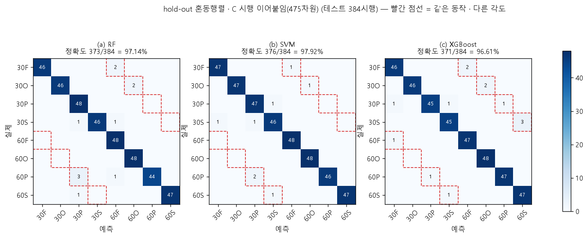
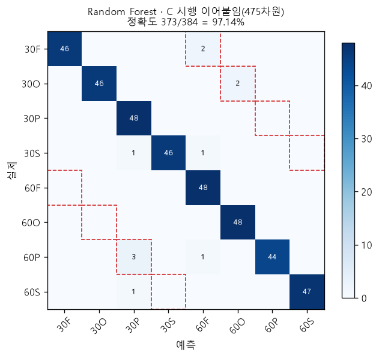
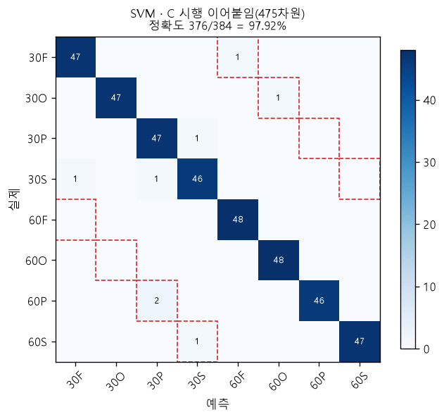
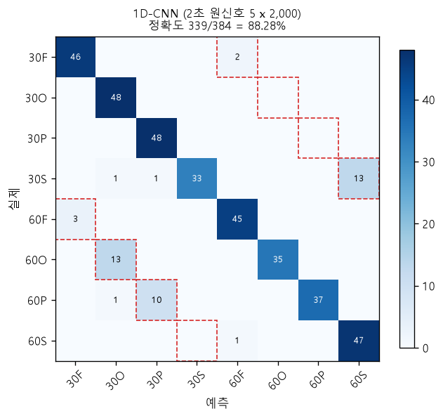
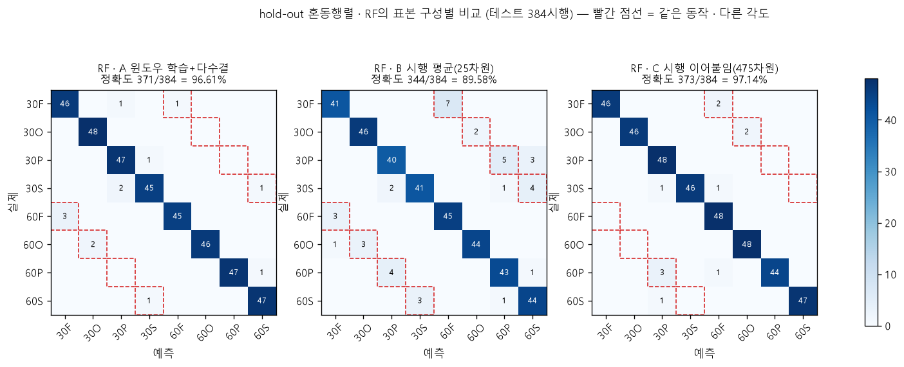
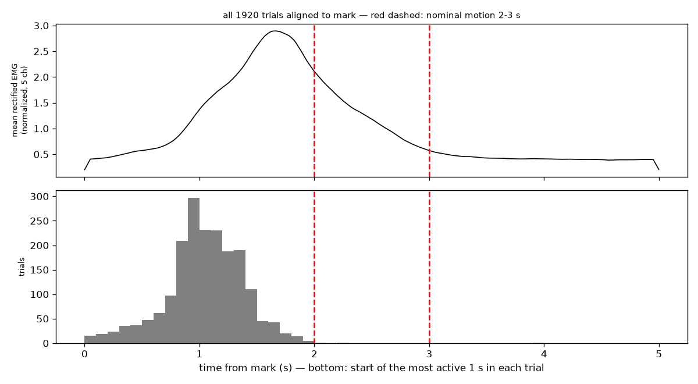
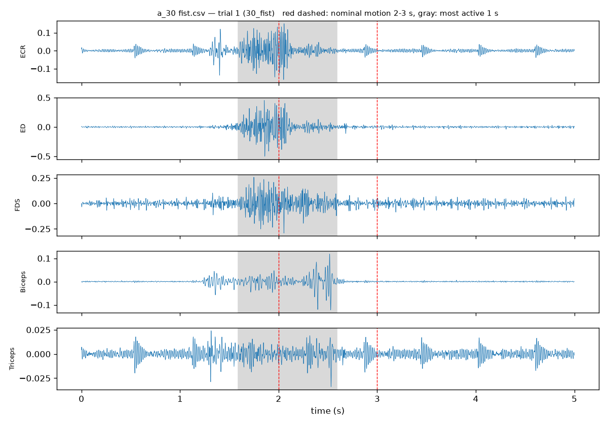
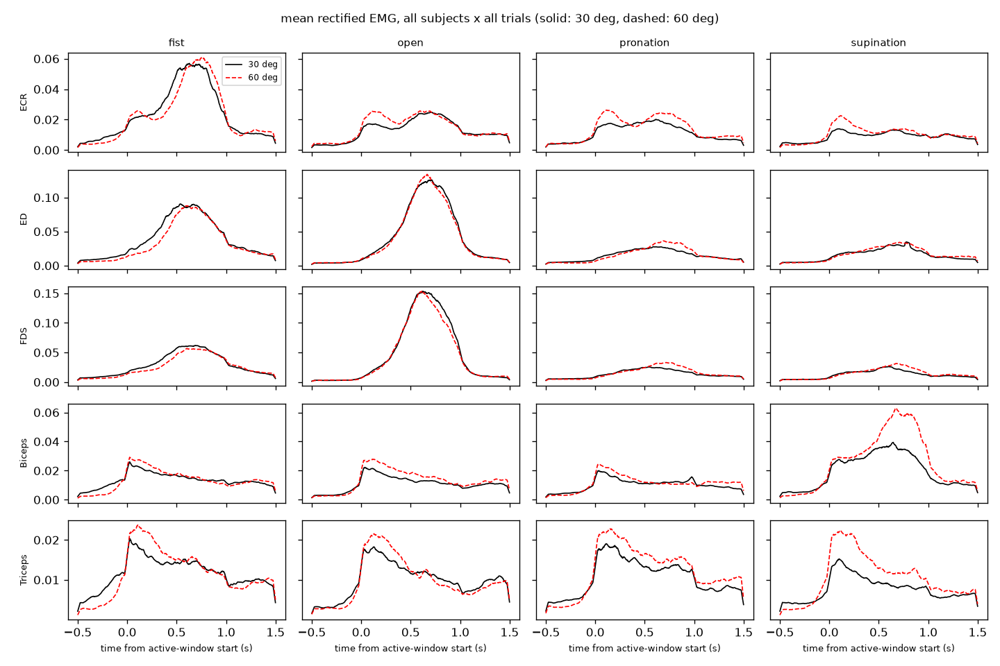
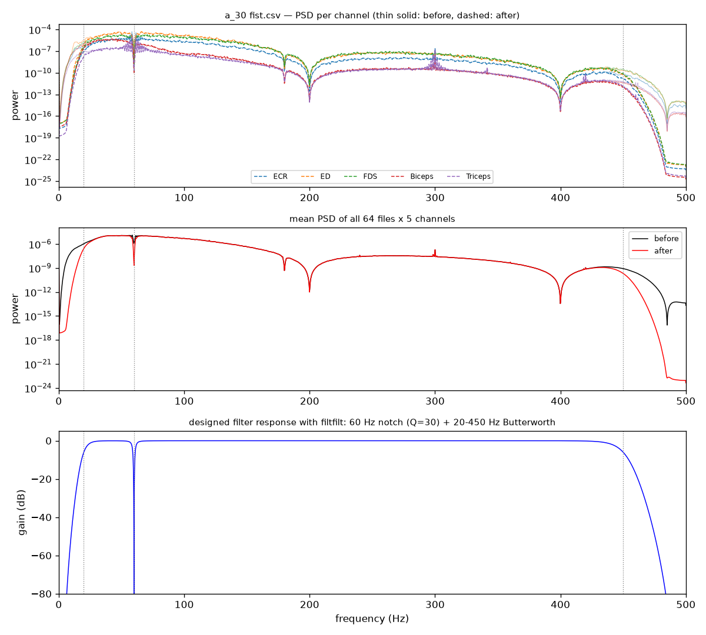
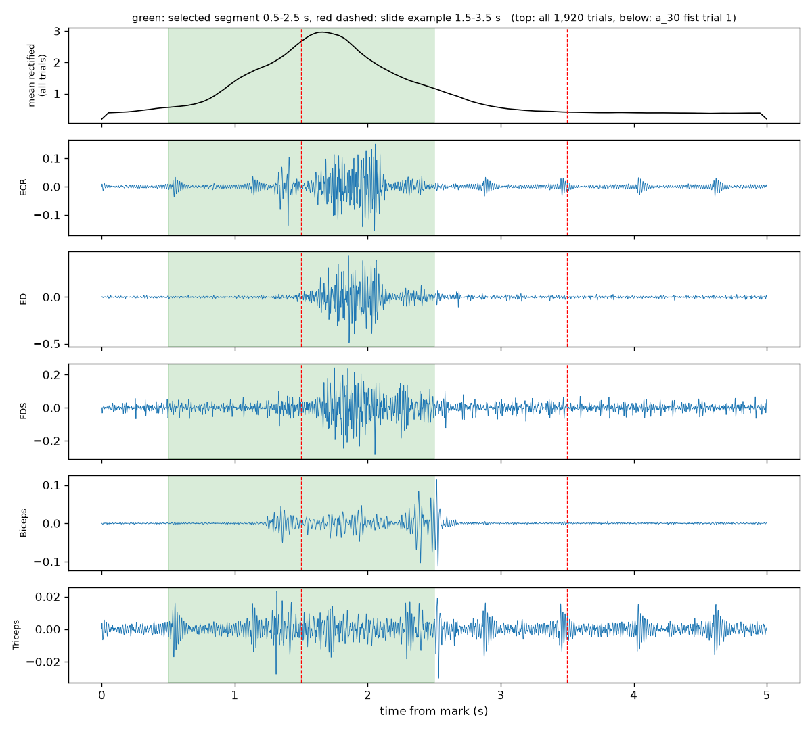

# sEMG 손동작 · 팔꿈치 각도 동시 분류 — 논문 재현 및 모델 성능 비교

대구가톨릭대학교 「딥러닝프로그래밍」 Step 2 과제 (21113103 김근영)

- 재현 대상 논문: Lee, S., Kim, J., & Choi, S.-I. (2026). *Simultaneous classification of hand gestures and elbow angles using sEMG signals: a comparison of machine learning performances.* Biomedical Engineering Letters. DOI 10.1007/s13534-026-00607-7
- 데이터: [TestUser-alt-dev/sEMG-Hand-Gesture-Elbow-Angle-Dataset](https://github.com/TestUser-alt-dev/sEMG-Hand-Gesture-Elbow-Angle-Dataset)
- 문제: 전완 3채널 + 상완 2채널 sEMG(1 kHz)로 손동작 4종(fist · open · pronation · supination) × 팔꿈치 각도 2종(30° · 60°) = 8클래스를 한 번에 분류한다.

## 한눈에 보는 결과

| 항목 | 논문 | 본 재현 (입력 표본 구성 C) |
|---|---|---|
| hold-out 정확도 (RF / SVM / XGBoost) | 96.88 / 96.35 / 95.57% | **97.14 / 97.92 / 96.61%** |
| hold-out macro F1 (RF / SVM / XGBoost) | 96.87 / 96.35 / 95.59% | **97.15 / 97.92 / 96.61%** |
| 5-fold 교차검증 (RF / SVM / XGBoost) | 96.72 ± 0.58 / 95.83 ± 0.79 / 96.15 ± 0.56% | **97.19 ± 0.69 / 97.81 ± 0.35 / 96.77 ± 0.61%** |
| 5-fold 순위 | RF > XGBoost > SVM | **SVM > RF > XGBoost** |
| 대응표본 t-검정 (5-fold) | 세 쌍 모두 유의하지 않음 (p = 0.1193 · 0.3739 · 0.1609) | SVM > RF p = 0.0240, SVM > XGBoost p = 0.0407, RF vs XGBoost p = 0.4557. 다중 비교 · 폴드 겹침을 보정하면 모두 유의하지 않음 |
| 주요 오류 | 같은 동작의 다른 각도 | 세 모델 오류 32건 중 23건(72%)이 같은 동작의 30° ↔ 60° 혼동. RF 최다 오류 60P → 30P (논문 Fig. 5와 같은 칸) |
| 모델 크기 (RF / SVM / XGBoost) | 4.31 / 4.36 / 3.59 MB | 4.30 / 4.43 / 3.67 MB |
| 학습 시간 | XGBoost만 19.8 s, 나머지 0.3 s 안팎 | XGBoost만 33.2 s, 나머지 0.4 s 미만 (노트북 CPU, 직접 비교 불가) |
| 처음 보는 사람 (LOSO) | 하지 않음 (논문의 향후 과제) | **46.35 \~ 50.57%** (각도만 채점하면 우연 50%에 가까운 58.85 \~ 63.54%) |
| (심화) 1D-CNN, 원신호 입력 | – | hold-out 88.28%, 5-fold 85.52 ± 4.03% (세 모델보다 유의하게 낮음) |

논문은 한 시행(2초)의 윈도우 19개를 모델의 표본으로 어떻게 묶었는지 밝히지 않았다. 그래서 세 가지 방법(A · B · C, 1.4절)을 같은 조건에서 모두 돌렸고, 논문 수치와 가장 가까운 **C(윈도우 19개 특징을 시간 순서대로 이어 붙인 475차원)** 를 본문으로 썼다. 같은 SVM이 표본 구성에 따라 5-fold 83.65%(A)에서 97.81%(C)까지 달라지고 모델 순위도 바뀐다. 이것이 이 재현의 가장 중요한 발견이다(2절).

3주차 최종 제출물(실습자료 17쪽)과 리포트 7개 항목이 이 README의 어디에 있는지:

| 제출물 | 위치 |
|---|---|
| ① 리포트 (7개 항목 구조) | 이 README 전체 (아래 표) |
| ② 성능 비교표 (세 모델 × 네 지표, hold-out) | 2절 첫 표 |
| ③ 교차검증 결과 (폴드별 값 + 평균 ± 표준편차) | 2절 "5-fold 교차검증" |
| ④ 통계 검정 (세 쌍의 p값과 해석) | 2절 "대응표본 t-검정" |
| ⑤ 혼동행렬 (`confusion8.png` + 오류 구조 해석) | 3절 |
| ⑥ 계산 비용 (학습 · 추론 시간) | 2절 "계산 비용" |
| ⑦ 한계 (trial-wise 분할 포함 세 가지 이상) | 4절 "한계" (다섯 가지) |

| 리포트 항목 | 위치 |
|---|---|
| 1. 문제 정의 (8클래스 동시 분류, 성공 기준) | 1.1 |
| 2. 데이터 (출처 · 규모 · 시행 단위 분할 · 전처리 순서) | 1.2, 부록 A · B |
| 3. 방법 (모델 설정 · 입력 표본 구성 · 평가 방법) | 1.3, 1.4 |
| 4. 결과 (비교표 · 교차검증 · 통계 검정 · 계산 비용) | 2 |
| 5. 오류 분석 (혼동행렬과 오류 구조) | 3 |
| 6. 한계 | 4 |
| 7. 재현 정보 (환경 · 난수 · 실행 순서) | 1.5, 5 |

---

## 1. 코드 설명

### 1.1 문제 정의

전완 3채널(ECR · ED · FDS)과 상완 2채널(Biceps · Triceps) sEMG의 **2초 구간 하나**를 보고, 손동작 4종(주먹 · 펴기 · 회내 · 회외)과 팔꿈치 각도 2종(30° · 60°)을 **한꺼번에 8클래스 중 하나로** 맞히는 문제다. 손동작만 맞히는 기존 연구와 달리, 같은 손동작이라도 팔을 얼마나 굽혔는지에 따라 다른 클래스로 본다.

- **성공 기준**: 논문의 hold-out 정확도(RF 96.88%, SVM 96.35%, XGBoost 95.57%)와 5-fold 정확도(RF 96.72 ± 0.58%) 수준을 재현하고, 세 모델의 차이가 우연인지를 통계 검정으로 판단하는 것.
- **평가 단위**: 시행. 논문의 테스트 384개는 시행 수(1,920 × 0.2)이므로 모든 정확도를 시행 단위로 계산한다.
- **클래스 표기**: `30F` = 30° 주먹, `O` = 펴기(open), `P` = 회내(pronation), `S` = 회외(supination). 논문 Fig. 5와 같은 표기다.

### 1.2 사용한 데이터 및 전처리

| 항목 | 내용 |
|---|---|
| 규모 | 피험자 8명(a\~h) × 8클래스 × 30시행 = **1,920시행** (클래스당 240, 피험자당 240으로 완전 균형) |
| 파일 | 64개 CSV = 피험자 8명 × 8조건. 파일 하나에 한 조건의 30회 반복이 **연속으로** 기록되어 있다(150,721\~153,601행) |
| 시행 경계 | `mark = 1` 이 파일마다 정확히 30번, 5,000샘플(5초) 간격 → 이것으로 시행을 자른다 (`week1/common.py`) |
| 채널 | `bandpass 1~5` = ECR, ED, FDS, Biceps, Triceps (1 kHz). 배포된 신호는 이미 대역통과 필터를 거친 것이다 |

**전처리 순서** (2주차 `week2/step1~6`):

1. **필터**: 60 Hz 노치(Q = 30) → 20\~450 Hz 4차 Butterworth 대역통과, `filtfilt`(위상 지연 없음). 파일 하나의 연속 기록 전체에 적용한다. 배포 신호가 이미 필터링돼 있어 전체 전력은 6.1%만 줄었고, 60 Hz 잡음이 남아 있던 일부 기록에서 노치가 실제로 작용했다(부록 B).
2. **분석 구간 2초**: `mark` 뒤 **0.5\~2.5초**. 논문은 시작점을 밝히지 않아 **재현 가정**이다. 프로토콜은 휴식 2초 → 동작 1초 → 휴식 2초이지만 실제 근활성은 `mark` 뒤 약 1\~2.5초에 나타난다(전체 평균 정점 1.65초). 시행마다 근활성이 가장 큰 1초가 2초 구간에 통째로 들어오는 비율이 0.5초 시작에서 86.8%로 가장 높아 이 값을 골랐다(강의 예시 1.5초는 6.6%). 라벨은 쓰지 않았다.
3. **윈도우**: 200 ms, 50% 오버랩(증분 100 ms) → 시행당 **19개**.
4. **특징**: 윈도우마다 채널별 시간영역 특징 5종 — RMS, MAV, WL, ZC(임계값 0.01), SSC(임계값 0.01) → 5 × 5 = **25차원**.
5. **분할**: **시행 단위로 먼저** 8:2로 나눈 뒤 각 집합 안에서만 윈도우와 특징을 만든다. 층 = 피험자 × 클래스(64층, 파일마다 학습 24 / 테스트 6시행), `random_state = 42`. 학습 1,536시행 / 테스트 384시행이며 두 집합에 함께 들어간 시행은 0개다(`week2/step5_dataset.py`). 윈도우를 먼저 만들고 나누면 같은 시행에서 100 ms만 어긋난 거의 같은 조각이 학습과 테스트 양쪽에 들어가므로 이 순서를 지킨다.
6. **표준화**: StandardScaler를 **학습 표본으로만** fit 한다. 5-fold와 LOSO에서는 매번 학습 쪽으로 다시 fit 한다.

### 1.3 사용한 모델

세 모델 모두 **논문 설정 그대로**다(본 강의자료 32\~34쪽, 3주차 실습자료 9쪽). `week3/common3.py`의 `make_models()` 한곳에서 만든다.

| 모델 | 설정 | 비고 |
|---|---|---|
| **SVM** | `SVC(kernel='rbf', C=1.0, gamma='scale', decision_function_shape='ovr')` | 기본값 |
| **Random Forest (RF)** | `RandomForestClassifier(n_estimators=100, random_state=42, n_jobs=-1)` | 나머지 기본값 |
| **XGBoost** | `XGBClassifier(objective='multi:softprob', n_estimators=400, max_depth=6, learning_rate=0.05, subsample=0.9, colsample_bytree=0.8, reg_lambda=1.0, tree_method='hist', random_state=42)` | 논문의 예비 튜닝 결과 |
| (심화) 1D-CNN | 2초 원신호 5 × 2,000 입력. Conv1d 4층(32 → 64 → 128 → 128, 각 BN-ReLU) → 전역 평균 풀링 → Dropout 0.3 → Linear(128 → 8). 파라미터 107,656개 | 논문의 향후 과제 "딥러닝 비교" (`week3/ext5_cnn1d.py`) |

- XGBoost의 `objective` · `reg_lambda` · `tree_method`는 실습 코드에는 없지만 논문 설정이라 적어 두었다(xgboost 3.4.1 기본값과 같은 값이라 결과는 같다). 라벨은 슬라이드대로 0\~7 정수로 넣는다.
- 논문은 SVM · RF는 기본값, XGBoost만 예비 튜닝을 했다. 그러므로 세 모델의 비교가 완전히 대칭적이지는 않다(실습자료 5쪽).
- 1D-CNN 학습: Adam lr 0.001, weight decay 0.0001, 배치 32, **60 epoch 고정**(마지막 epoch 모델로 평가), seed 42. 테스트셋을 보고 멈출 시점을 고르지 않으려고 epoch를 고정했다.

### 1.4 학습 및 테스트 방법

**입력 표본 구성 (재현 가정).** 논문은 "윈도우당 25차원"과 "학습 1,536 / 테스트 384"만 밝혔다. 한 시행의 윈도우 19개를 모델에 어떻게 넣었는지는 없다. 그래서 세 가지를 **같은 분할 · 같은 모델 설정**으로 모두 학습했다(`week3/common3.py`의 `represent`).

| 구성 | 모델에 들어가는 표본 하나 | 학습 표본 수 | 시행 하나의 판정 |
|---|---|---|---|
| A | 윈도우 1개 (25차원) — 실습자료 9쪽 코드 그대로 | 29,184 | 윈도우 19개 예측의 다수결 (동점이면 번호가 작은 클래스) |
| B | 시행 1개 = 윈도우 19개 특징의 **평균** (25차원) | 1,536 | 예측 그대로 |
| **C (본문)** | 시행 1개 = 윈도우 19개 특징을 **시간 순서대로 이어 붙임** (19 × 25 = 475차원) | 1,536 | 예측 그대로 |

**C를 본문으로 고른 이유**: 세 구성 중 C만 논문 보고값과 여러 면에서 맞았다. hold-out 정확도가 세 모델 모두 96% 이상이고 논문과의 차이가 +0.26 \~ +1.57%p다(A는 −12.76 \~ −0.27%p, B는 −7.30 \~ −3.38%p). 모델 크기도 RF 4.30 · SVM 4.43 · XGBoost 3.67 MB로 논문 Table 5(4.31 · 4.36 · 3.59 MB)와 거의 같다. 반면 A의 RF는 178.88 MB, B의 SVM은 0.27 MB로 논문과 크게 다르다. 다만 이것은 결과를 보고 고른 것이므로 "논문이 C로 했다"는 증거는 아니며, A · B의 결과도 모든 표에 함께 적었다.

| 평가 | 방법 | 코드 |
|---|---|---|
| hold-out | 2주차 분할 그대로 학습 1,536 / 테스트 384시행. Accuracy, macro Precision · Recall · F1 | `step2_holdout.py` |
| 혼동행렬 | hold-out 예측으로 8 × 8 행렬. 오류를 "같은 동작 · 다른 각도 / 같은 각도 · 다른 동작 / 둘 다 다름"으로 나눠 센다 | `step3_confusion.py` |
| 5-fold 교차검증 | 1,920시행을 `StratifiedKFold(5, shuffle=True, random_state=42)`로 나눔(층 = 피험자 × 클래스, 폴드마다 384시행). 특징은 미리 만들어 두고 인덱스로만 나누며, 표준화는 폴드마다 학습 폴드로 다시 fit | `step4_cv.py` |
| 통계 검정 | 같은 폴드끼리 짝지은 대응표본 t-검정(`scipy.stats.ttest_rel`, α = 0.05), 세 쌍 | `step5_ttest.py` |
| 계산 비용 | 학습 시간(3회 중앙값), 추론 시간(표본 1개씩 100회 평균 + 384개 묶음), pickle 모델 크기 | `step6_cost.py` |
| 한계 점검 | 동작이 없는 휴식 구간(`mark` 뒤 4\~5초)만으로 같은 분류를 해 본다 | `step7_rest_check.py` |

- macro 평균은 실습 선택이다(논문은 평균 방식을 밝히지 않음). 테스트셋이 클래스마다 48시행으로 같아 weighted 평균과 값이 같다.
- 한 시행의 윈도우 19개는 학습 · 평가 중 **항상 같은 쪽**에 들어간다.

### 1.5 실행 방법

```bash
# 0) 환경 (Python 3.14.0에서 검증)
python -m venv .venv
.venv\Scripts\activate             # macOS/Linux: source .venv/bin/activate
pip install -r requirements.txt
pip install torch                  # 심화 1D-CNN(ext5)만 필요. GPU가 있으면 CUDA 빌드 권장

# 1) 데이터 받기 (저장소 루트에 data/ 로, 약 1 GB)
git clone --depth 1 https://github.com/TestUser-alt-dev/sEMG-Hand-Gesture-Elbow-Angle-Dataset.git data

# 2) 1주차: 데이터 구조 확인 · 신호 그림
cd week1
python step1_env_check.py      # 패키지 버전          -> env_versions.txt
python step2_data_check.py     # 파일 수 · 폴더 구조
python step3_explore.py        # 클래스별 시행 수     -> data_summary.md
python step4_plot.py           # 그림 · RMS 표        -> *.png, motion_timing.md, angle_rms_table.md

# 3) 2주차: 전처리 → 특징 → 시행 단위 분할 → 표준화  (약 1분)
cd ../week2
python step1_filter.py         # 60 Hz 노치 + 20~450 Hz 대역통과 -> filter_check.png / .md
python step2_segment.py        # 2초 분석 구간(mark + 0.5초)     -> segment_start.md, segment_check.png
python step3_window.py         # 200 ms / 100 ms 윈도우          -> (19, 200, 5)
python step4_features.py       # RMS · MAV · WL · ZC · SSC       -> (25,), feature_order.md
python step5_dataset.py        # 시행 단위 분할 후 특징 생성     -> step5_features.npz
python step6_scale_save.py     # 표준화 · 저장                   -> dataset.npz, dataset_summary.md

# 4) 3주차: 학습 · 평가 · 교차검증 · 검정 · 계산 비용  (약 15분)
cd ../week3
python step1_train.py          # 세 구성 × 세 모델 학습            -> models/*.pkl
python step2_holdout.py        # hold-out 네 지표 (②)              -> holdout_metrics.md
python step3_confusion.py      # 혼동행렬 · 오류 구조 (⑤)          -> confusion8.png, confusion_{svm,rf,xgb}.png, confusion_analysis.md
python step4_cv.py             # 5-fold 교차검증 · 피험자별 (③)     -> cv_results.md
python step5_ttest.py          # 대응표본 t-검정 (④)               -> ttest.md
python step6_cost.py           # 학습 · 추론 시간, 모델 크기 (⑥)    -> cost.md
python step7_rest_check.py     # 휴식 구간 점검 (⑦ 한계 1)         -> rest_check.md

# 5) 심화 과제 (본 강의자료 54쪽, 약 55분)
python ext1_loso.py            # LOSO                               -> ext1_loso.md
python ext2_channels.py        # 채널 어블레이션                    -> ext2_channels.md
python ext3_freq_window.py     # 주파수 특징 MNF · MDF, 윈도우 길이  -> ext3_freq_window.md
python ext4_hierarchical.py    # 계층적 분류 (손동작 → 각도)        -> ext4_hierarchical.md
python ext5_cnn1d.py           # 1D-CNN (원신호)                    -> ext5_cnn1d.md
python ext5_confusion.py       # 1D-CNN 혼동행렬                    -> confusion_cnn1d.png, ext5_confusion.md
```

Windows에서는 `week1/run_all.bat`, `week2/run_all.bat`, `week3/run_all.bat` 으로 주차별 단계를 한 번에 실행할 수 있다(파일 안의 가상환경 경로만 맞게 고치면 된다). 3주차 전체는 약 1시간 10분 걸린다.

### 1.6 코드 파일 설명

| 파일 | 설명 |
|---|---|
| `week1/common.py` | CSV 찾기, 파일명 → 라벨(`label_of`), `mark`로 시행 자르기, 시행별 근활성이 가장 큰 1초 찾기(`active_starts`) |
| `week1/step1~4_*.py` | 환경 확인, 데이터 구조 확인, 클래스별 시행 수, 5채널 · 각도 비교 그림 |
| `week1/class_design.md` | 1주차 클래스 설계안 |
| `week2/step1_filter.py` | 60 Hz 노치 + 20\~450 Hz 대역통과 (`preprocess`), 필터 전후 비교 그림 |
| `week2/step2_segment.py` | 2초 분석 구간 자르기 (`cut`, 시작점 후보 비교) |
| `week2/step3_window.py` | 200 ms / 100 ms 슬라이딩 윈도우 (`make_windows`) |
| `week2/step4_features.py` | 시간영역 특징 5종 × 5채널 = 25차원 (`td_features`) |
| `week2/step5_dataset.py` | **시행 단위로 먼저 분할**한 뒤 특징 생성 (누수 방지) → `step5_features.npz`(표준화 전) |
| `week2/step6_scale_save.py` | 학습셋으로만 fit 한 표준화 → `dataset.npz` |
| `week2/setting_rationale.md` | 설정 근거, 논문 조건과 재현 가정 구분표 |
| `week3/common3.py` | **3주차 공용**: 모델 설정(`make_models`), 표본 구성 A · B · C(`represent`, `vote`), 학습 · 예측(`fit`, `predict`), 5-fold 분할(`cv_splits`), 오류 분류(`error_types`), 혼동행렬 그리기(`draw_confusion`) |
| `week3/step1_train.py` | 세 구성 × 세 모델을 hold-out 학습셋으로 학습 → `models/*.pkl` |
| `week3/step2_holdout.py` | hold-out 네 지표, 학습 표본 순서 점검 → `holdout_metrics.md`, `holdout_pred.npz` |
| `week3/step3_confusion.py` | 혼동행렬 그림, 오류 구조, 클래스별 Precision · Recall · F1 → `confusion*.png`, `confusion_analysis.md` |
| `week3/step4_cv.py` | 5-fold 교차검증, 피험자별 정확도 → `cv_results.md`, `cv_results.npz` |
| `week3/step5_ttest.py` | 대응표본 t-검정 (보정 t-검정 · 표본 구성 사이 비교 포함) → `ttest.md` |
| `week3/step6_cost.py` | 학습 · 추론 시간, 모델 크기, 특징 추출 시간 → `cost.md` |
| `week3/step7_rest_check.py` | 휴식 구간(`mark` 뒤 4\~5초)만으로 5-fold · LOSO 분류 → `rest_check.md` |
| `week3/ext1_loso.py` \~ `ext5_cnn1d.py`, `ext5_confusion.py` | 심화 과제 5종 (2절 끝) |
| `week3/run_all.bat` | 3주차 단계 1\~7 + 심화 전체 일괄 실행 |

---

## 2. 모델 성능 비교

### 성능 비교표 (hold-out, 테스트 384시행, 구성 C)

Precision · Recall · F1은 macro 평균이다. 행 순서는 논문 Table 2와 같다.

| Model | Accuracy | Precision | Recall | F1-score | 5-fold 평균 ± 표준편차 | 학습 시간 | 추론 (묶음 / 1개씩) | 모델 크기 |
|---|---|---|---|---|---|---|---|---|
| Random Forest | 97.14% | 97.36% | 97.14% | 97.15% | 97.19 ± 0.69% | 0.35 s | 0.068 / 28.8 ms | 4.30 MB |
| **SVM** | **97.92%** | **97.96%** | **97.92%** | **97.92%** | **97.81 ± 0.35%** | 0.19 s | 0.275 / 0.48 ms | 4.43 MB |
| XGBoost | 96.61% | 96.65% | 96.61% | 96.61% | 96.77 ± 0.61% | 33.23 s | 0.018 / 1.86 ms | 3.67 MB |
| (심화) 1D-CNN | 88.28% | 90.44% | 88.28% | 88.09% | 85.52 ± 4.03% | 16.7 s (GPU) | – / 0.97 ms (CPU) | 0.43 MB |
| 논문 RF | 96.88% | 96.95% | 96.88% | 96.87% | 96.72 ± 0.58% | 0.313 s | 0.036 ms | 4.31 MB |
| 논문 SVM | 96.35% | 96.41% | 96.35% | 96.35% | 95.83 ± 0.79% | 0.334 s | 0.382 ms | 4.36 MB |
| 논문 XGBoost | 95.57% | 95.67% | 95.57% | 95.59% | 96.15 ± 0.56% | 19.846 s | 0.031 ms | 3.59 MB |

(학습 · 추론 시간은 노트북 CPU 기준이고 논문과 측정 환경이 달라 직접 비교할 수 없다. 1D-CNN 학습만 GPU다.)

- **세 모델 모두 정확도 96.61% 이상**이고, 한 모델 안에서 네 지표의 차이가 0.22%p 이하다. 정확도만 높고 특정 클래스를 놓치는 일은 없었다(클래스별 값은 3절).
- 순위는 **SVM 97.92% > RF 97.14% > XGBoost 96.61%**로, RF가 1위인 논문과 다르다. 다만 1위와 3위의 차이는 384시행 중 5시행(376 대 371)이다. hold-out은 분할이 한 번뿐이라 이 순위는 아래 5-fold와 검정으로 다시 확인한다.

### 입력 표본 구성별 비교 (hold-out, 테스트 384시행)

| 표본 구성 | 모델 | Accuracy | Precision | Recall | F1-score | 논문 대비 정확도 (%p) |
|---|---|---|---|---|---|---|
| A 윈도우 학습 + 다수결 | RF | 96.61% | 96.67% | 96.61% | 96.62% | −0.27 |
| A 윈도우 학습 + 다수결 | SVM | 83.59% | 84.91% | 83.59% | 83.65% | −12.76 |
| A 윈도우 학습 + 다수결 | XGBoost | 92.97% | 93.40% | 92.97% | 92.88% | −2.60 |
| B 시행 평균 (25차원) | RF | 89.58% | 89.74% | 89.58% | 89.58% | −7.30 |
| B 시행 평균 (25차원) | SVM | 90.62% | 90.81% | 90.62% | 90.57% | −5.73 |
| B 시행 평균 (25차원) | XGBoost | 92.19% | 92.49% | 92.19% | 92.16% | −3.38 |
| **C 시행 이어붙임 (475차원)** | RF | 97.14% | 97.36% | 97.14% | 97.15% | +0.26 |
| **C 시행 이어붙임 (475차원)** | SVM | 97.92% | 97.96% | 97.92% | 97.92% | +1.57 |
| **C 시행 이어붙임 (475차원)** | XGBoost | 96.61% | 96.65% | 96.61% | 96.61% | +1.04 |
| A의 윈도우 단위 (테스트 7,296윈도우) | RF / SVM / XGBoost | 62.54 / 48.29 / 59.87% | | | | |

- **표본 구성의 영향이 모델 사이의 차이보다 훨씬 크다.** 같은 SVM이 A 83.59% / B 90.62% / C 97.92%로 14.33%p 달라진다.
- 슬라이드 코드(구성 A)가 바로 출력하는 **윈도우 단위 정확도는 48.29\~62.54%** 에 그친다. 200 ms 조각 하나로는 8클래스를 구분하기 어렵고, 19개를 다수결로 모아야 시행 단위 정확도가 올라간다. A의 SVM은 384시행 중 30시행에서 다수결이 동점이었다.
- **학습 표본 순서 점검**: 같은 표본 · 같은 설정에서 학습 표본을 넣는 순서만 시행 번호 순으로 바꿔도 RF 정확도가 C 97.14% → 97.92%, A 96.61% → 94.79%로 달라졌다. RF는 트리마다 표본 번호를 무작위로 뽑으므로 순서가 바뀌면 뽑히는 표본이 달라진다. 모델 사이의 1%p 안팎 차이는 이런 세부 조건으로도 생길 수 있는 크기다.

### 5-fold 교차검증

1,920시행을 시행 단위로 5개 폴드로 나눠, 폴드마다 나머지 4개(1,536시행)로 학습하고 그 폴드(384시행)로 평가했다.

| 모델 (구성 C) | fold 1 | fold 2 | fold 3 | fold 4 | fold 5 | **평균 ± 표준편차** | 논문 Table 3 |
|---|---|---|---|---|---|---|---|
| Random Forest | 97.14 | 96.88 | 98.44 | 96.35 | 97.14 | **97.19 ± 0.69** | 96.72 ± 0.58 |
| SVM | 97.92 | 97.66 | 98.44 | 97.40 | 97.66 | **97.81 ± 0.35** | 95.83 ± 0.79 |
| XGBoost | 97.66 | 96.61 | 96.61 | 97.14 | 95.83 | **96.77 ± 0.61** | 96.15 ± 0.56 |
| (심화) 1D-CNN | 83.85 | 88.02 | 79.17 | 85.42 | 91.15 | **85.52 ± 4.03** | – |

| 표본 구성 | RF | SVM | XGBoost | 순위 |
|---|---|---|---|---|
| A 윈도우 학습 + 다수결 | 96.35 ± 0.55 | 83.65 ± 1.01 | 95.78 ± 0.42 | RF > XGBoost > SVM (논문과 같은 순서) |
| B 시행 평균 (25차원) | 91.30 ± 1.16 | 90.89 ± 0.70 | 91.82 ± 1.34 | XGBoost > RF > SVM |
| **C 시행 이어붙임 (475차원)** | **97.19 ± 0.69** | **97.81 ± 0.35** | **96.77 ± 0.61** | **SVM > RF > XGBoost** |
| 논문 Table 3 | 96.72 ± 0.58 | 95.83 ± 0.79 | 96.15 ± 0.56 | RF > XGBoost > SVM |

- 구성 C의 순위는 hold-out과 같다(SVM > RF > XGBoost). 표준편차는 세 모델 모두 0.69%p 이하로 논문(0.56\~0.79%p)과 비슷한 크기다. 슬라이드 코드대로 `np.std`(ddof = 0)를 썼고, 표본 표준편차(ddof = 1)로는 RF 0.77 · SVM 0.39 · XGBoost 0.68%p다.
- **폴드에 따른 흔들림이 모델 사이의 차이와 비슷한 크기다.** RF는 폴드 3에서 98.44%, 폴드 4에서 96.35%로 2.09%p 흔들리는데, 세 모델의 평균 차이는 1.04%p 안이다. 평균만 보고 순위를 단정할 수 없어 같은 폴드끼리 짝지은 검정이 필요하다.
- **어떤 표본 구성을 쓰느냐에 따라 1위가 바뀐다.** A에서는 RF, B에서는 XGBoost, C에서는 SVM이 1위다.
- 이 표준편차는 "이번 5개 분할에서의 흔들림"이지, 처음 보는 사람에게도 안정적이라는 뜻이 아니다(4절 한계 1, LOSO).

피험자별 정확도 (5-fold 검증 예측을 피험자별로 모음, 피험자마다 240시행, 구성 C) — 논문 Table 4에 해당:

| 모델 | a | b | c | d | e | f | g | h | 범위 | 논문 Table 4 범위 |
|---|---|---|---|---|---|---|---|---|---|---|
| RF | 97.1 | 97.9 | 100.0 | 97.9 | 95.0 | 95.4 | 96.2 | 97.9 | 95.0\~100.0 | 94.2\~100 |
| SVM | 98.3 | 98.3 | 100.0 | 98.8 | 97.9 | 95.8 | 96.2 | 97.1 | 95.8\~100.0 | 87.5\~100 |
| XGBoost | 97.1 | 95.8 | 99.6 | 98.3 | 95.0 | 95.4 | 95.0 | 97.9 | 95.0\~99.6 | 94.6\~100 |

세 모델 모두 모든 피험자에서 95.0% 이상이고 피험자 c가 가장 높다. 논문의 한 피험자(LSJ)처럼 한 모델만 크게 떨어지는 사람은 없었다. 데이터 파일의 표기(a\~h)와 논문 이니셜의 대응은 알 수 없어 사람별 직접 비교는 하지 않았다.

### 대응표본 t-검정

위 5-fold의 폴드별 정확도를 같은 폴드끼리 짝지어 비교했다(슬라이드 13쪽 코드, α = 0.05).

| 비교 (구성 C) | 평균 차이 (%p) | 차이의 95% 신뢰구간 | 앞 모델이 높은 폴드 | t | **p** | 판정 | 참고: 보정 t-검정 p | 논문 p |
|---|---|---|---|---|---|---|---|---|
| SVM vs RF | +0.63 | +0.13 \~ +1.12 | 4/5 (동률 1) | 3.539 | **0.0240** | 유의함 | 0.0777 | 0.1193 |
| SVM vs XGBoost | +1.04 | +0.07 \~ +2.01 | 5/5 | 2.981 | **0.0407** | 유의함 | 0.1178 | 0.3739 |
| RF vs XGBoost | +0.42 | −0.99 \~ +1.82 | 3/5 | 0.825 | **0.4557** | 유의하지 않음 | 0.6115 | 0.1609 |

| 표본 구성 | SVM vs RF | SVM vs XGBoost | RF vs XGBoost |
|---|---|---|---|
| A 윈도우 학습 + 다수결 | **0.0000** (SVM이 낮음) | **0.0000** (SVM이 낮음) | **0.0295** |
| B 시행 평균 (25차원) | 0.5122 | 0.3360 | 0.5304 |
| C 시행 이어붙임 (475차원) | **0.0240** | **0.0407** | 0.4557 |
| 논문 | 0.1193 | 0.3739 | 0.1609 |

**해석**

- **SVM은 RF · XGBoost보다 슬라이드 기준(α = 0.05)으로 유의하게 높았다.** SVM은 다섯 폴드 중 RF보다 4번 높고 1번 같았으며, XGBoost보다는 5번 모두 높았다. 평균 차이는 0.63%p, 1.04%p로 폴드마다 384시행 중 2\~4시행 정도이고, 신뢰구간의 아래 끝(+0.13, +0.07%p)이 0에 가깝다. **차이의 방향은 일관되지만 크기는 작다.**
- **RF와 XGBoost의 차이는 유의하지 않았다**(p = 0.4557, 신뢰구간이 0을 포함). 이것은 두 모델이 같다는 증거가 아니라, **이 다섯 폴드로는 차이를 검출하지 못했다는 뜻**이다(본 강의자료 41쪽).
- **그러나 SVM의 우위는 근거가 약하다.** 5-fold의 학습 폴드는 서로 75%씩 겹쳐 폴드 정확도가 독립이 아니다. 보통의 대응표본 t-검정은 이 겹침을 무시해 p값이 작게 나오는 쪽으로 치우친다. 이를 보정하는 Nadeau & Bengio(2003)의 보정 t-검정(분산 × (1/5 + 384/1536))으로는 SVM vs RF p = 0.0777, SVM vs XGBoost p = 0.1178로 둘 다 유의하지 않다. 세 쌍을 동시에 검정한 것을 Bonferroni로 보정해도(α = 0.05 / 3 ≈ 0.0167) 유의한 쌍이 없다. 폴드가 5개뿐이라 비모수 검정(Wilcoxon 부호순위)은 가장 작은 p가 0.0625여서 처음부터 유의할 수 없다. 따라서 결론은 **"슬라이드 기준으로는 SVM이 유의하게 높지만, 그 근거는 약하다"** 이다.
- **논문과 결론이 다르다.** 논문은 세 쌍 모두 p > 0.05였고 RF가 평균 1위였다. 같은 SVM이 구성 A에서는 83.65%로 꼴찌이고 RF · XGBoost보다 유의하게 낮다(p < 0.0001). B에서만 논문처럼 세 쌍 모두 유의하지 않았지만 B는 정확도 자체가 논문보다 5%p 낮다. **세 표본 구성 중 논문의 수치와 결론을 동시에 재현한 것은 없었다.**

### 논문 Table 2 · 3 · 5와 비교

| 모델 | hold-out 정확도 (논문 → 본 재현) | 5-fold (논문 → 본 재현) | 모델 크기 (논문 → 본 재현) | 학습 시간 (논문 → 본 재현) |
|---|---|---|---|---|
| RF | 96.88% → 97.14% (+0.26%p) | 96.72 → 97.19% (+0.47%p) | 4.31 → 4.30 MB | 0.313 → 0.354 s |
| SVM | 96.35% → 97.92% (+1.57%p) | 95.83 → 97.81% (+1.98%p) | 4.36 → 4.43 MB | 0.334 → 0.193 s |
| XGBoost | 95.57% → 96.61% (+1.04%p) | 96.15 → 96.77% (+0.62%p) | 3.59 → 3.67 MB | 19.846 → 33.232 s |

- 세 모델 모두 정확도가 논문과 2%p 안이고, 모델 크기는 0.08 MB 안에서 같다. **"XGBoost만 학습이 수십 배 느리다"** 는 계산 비용의 모양도 같다.
- 다른 것은 **순위와 검정 결론**이다. 정확도 차이가 1%p 안팎인 세 모델에서는, 표본 구성 · 세그먼트 시작점 · 분할 난수 같은 세부 조건이 순위를 바꿀 만큼 크다(4절 "논문과 다르게 나온 이유").
- 논문은 Table 2와 Fig. 5 혼동행렬에서 계산한 정확도가 서로 다르다(본 강의자료 45\~46쪽). 이 재현의 표와 혼동행렬(3절)은 같은 예측에서 나왔으므로 서로 일치한다.

### 계산 비용

측정 환경: Intel Core i5-10200H (논리 코어 8개), Windows 11, Python 3.14.0, scikit-learn 1.9.1, xgboost 3.4.1, GPU 미사용, 충전기 연결 상태. hold-out 학습셋(1,536시행)으로 학습하는 시간을 3번 재 중앙값을 썼고, 추론은 슬라이드 14쪽 방식(표본 1개 `predict` 100회 평균)과 테스트셋 384개를 한 번에 예측한 표본당 시간(묶음)을 함께 쟀다. 모델 크기는 pickle 바이트 수(MB = 10⁶ 바이트)다.

| 표본 구성 | 모델 | 학습 표본 수 | 학습 시간 (s) | 추론 1개씩 (ms) | 추론 묶음 (ms/표본) | 시행 1개 판정 (ms) | 모델 크기 (MB) |
|---|---|---|---|---|---|---|---|
| **C** | RF | 1,536 | 0.354 | 28.816 | 0.0684 | 28.816 | 4.30 |
| **C** | SVM | 1,536 | 0.193 | 0.478 | 0.2754 | 0.478 | 4.43 |
| **C** | XGBoost | 1,536 | 33.232 | 1.864 | 0.0176 | 1.864 | 3.67 |
| A | RF | 29,184 | 2.395 | 25.889 | 0.0065 | 25.909 | 178.88 |
| A | SVM | 29,184 | 36.896 | 2.529 | 2.2785 | 42.787 | 6.78 |
| A | XGBoost | 29,184 | 8.298 | 2.179 | 0.0161 | 5.123 | 11.57 |
| B | RF | 1,536 | 0.266 | 28.679 | 0.0688 | 28.679 | 4.74 |
| B | SVM | 1,536 | 0.067 | 0.280 | 0.1021 | 0.280 | 0.27 |
| B | XGBoost | 1,536 | 2.335 | 1.232 | 0.0139 | 1.232 | 4.33 |

("시행 1개 판정"은 A에서 윈도우 19개를 예측한 뒤 다수결하는 시간이다. 특징 추출은 시행당 1.85 ms.)

- **XGBoost 학습이 가장 느리다.** 33.23초로 RF(0.35초)의 94배, SVM(0.19초)의 172배다. 트리 400개 × 8클래스 = 트리 3,200개를 앞 트리의 오차를 보며 차례로 쌓기 때문이고(부스팅), 논문과 같은 양상이다. RF는 트리 100개를 서로 독립적으로 CPU 8개에 나눠 학습해 빠르다.
- **표본 1개씩 추론하면 RF가 가장 느리다(28.8 ms).** 논문 설정 `n_jobs = -1`은 `predict`를 부를 때마다 CPU 여러 개에 일을 나눠 주는 준비를 하는데, 표본이 1개면 이 준비 시간이 대부분이다. 같은 모델을 `n_jobs = 1`로만 바꾸면 7.5 ms로 줄고, 384개를 한 번에 예측하면 표본당 0.068 ms다.
- **묶음 추론의 순서는 XGBoost 0.018 < RF 0.068 < SVM 0.275 ms로 논문(0.031 < 0.036 < 0.382 ms)과 같다.** 논문의 추론 시간은 묶음으로 잰 값에 가까워 보인다. SVM은 예측할 때 서포트 벡터 전부와 커널 값을 계산해야 해 묶음에서도 가장 느리다.
- 구성 A는 학습 표본이 19배라 SVM 학습이 36.9초, RF 모델이 178.9 MB로 커진다. 정확도뿐 아니라 실용성 면에서도 불리하다.
- **실제 지연은 신호 취득이 대부분이다.** 한 번 판정하려면 2초 신호를 모아야 하고, 특징 추출 1.85 ms와 분류 0.5\~28.8 ms(1개씩)는 그보다 훨씬 작다. 노트북 CPU에서 잰 값이라 실제 배포 장치에서는 따로 재야 한다.
- 이 측정은 2026-10-19 충전기를 연결한 상태에서 다시 쟀다. 같은 날 배터리 전원에서 쟀을 때는 RF 1개씩 추론이 59.5 ms로 두 배 느렸다. 시간 값은 전원 · 다른 프로그램 등 측정 조건에 따라 크게 달라지므로(한계 5) 순서와 배율 위주로 읽어야 한다.

### 성능 분석

- **가장 높은 모델은 SVM이다** (구성 C, hold-out 97.92% / F1 97.92%, 5-fold 97.81 ± 0.35%). 5-fold 평균이 가장 높고 표준편차도 가장 작아 폴드에 덜 흔들렸다. 475차원 벡터는 "언제 어느 채널이 얼마나 활성화됐는가"라는 시간 모양을 그대로 담고 있다. 거리로 비교하는 RBF 커널은 이런 모양 전체가 비슷한 시행끼리 묶는 데 유리했을 수 있다. 같은 SVM이 시간 정보를 버린 B(90.89%)나 윈도우 하나씩 본 A(83.65%)에서 크게 떨어진 것과도 맞는 설명이지만, 원인을 따로 떼어 확인한 실험은 아니다.
- **RF는 표본 구성에 가장 덜 민감했다**(5-fold A 96.35% / C 97.19%, p = 0.2272). 트리는 특징 하나씩 기준을 세우므로 윈도우 하나(25차원)로도 쓸 만한 기준을 찾는다. 논문에서 RF가 1위였던 것도, 논문의 표본 구성이 A에 가까웠다면 설명이 된다(A에서 RF가 1위). 다만 확인할 수는 없다.
- **XGBoost는 세 모델 중 가장 낮았지만 RF와의 차이는 유의하지 않다**(p = 0.4557). 학습은 가장 느리지만(33.2초) 묶음 추론은 가장 빠르다(표본당 0.018 ms). 논문의 예비 튜닝 값을 그대로 썼는데, 그 튜닝은 논문의 표본 구성에서 한 것이므로 475차원 입력에는 최적이 아닐 수 있다.
- **세 모델의 차이(1%p 안)보다 입력 표본 구성의 차이(최대 14%p)가 훨씬 크다.** 이 데이터에서 성능을 정하는 것은 모델 종류보다 "한 시행을 어떻게 표현하느냐"다.
- **(심화) 1D-CNN은 가장 낮았다**(5-fold 85.52 ± 4.03%, 세 모델보다 p < 0.01로 유의하게 낮음). 학습 시행 1,536개는 딥러닝에 작은 데이터이고, 원신호에서 특징을 스스로 찾아야 하는 반면 세 모델은 진폭 · 파형 특징을 이미 받는다. 폴드에 따라 79.17\~91.15%로 크게 흔들린 것도 데이터가 작다는 신호다. 구조와 학습 설정을 하나도 조정하지 않은 결과이므로 "이 설정의 작은 CNN은 시간영역 특징 + 고전 모델을 넘지 못했다"로 한정해서 읽어야 한다.
- **누수 점검**: 97% 안팎의 정확도가 "너무 높은 것"은 아닌지 확인했다. (a) 분할은 시행 단위로 먼저 하고 그 안에서만 윈도우를 만들었다(학습 · 테스트 공통 시행 0개). (b) 표준화는 매번 학습 쪽으로만 fit 했다. (c) 정확도가 99%를 넘지 않고 논문 수준이다. 그러나 **동작이 없는 휴식 구간만으로도 65\~90%가 나와**, 같은 기록 파일 안에서의 성능이라는 한계가 있다(4절 한계 1). 이것은 분할 순서의 실수가 아니라 데이터 구조(파일 하나 = 한 조건 30회 연속 기록)에서 오는 것이다.

### 심화 과제 (본 강의자료 54쪽)

모두 본문과 같은 5개 폴드 · 같은 모델 설정으로 평가했다. 결과는 구성 C 기준이며 A · B 결과는 각 md 파일에 있다.

| 실험 | 결과 (구성 C, 5-fold) | 파일 |
|---|---|---|
| **LOSO** (7명 학습 / 1명 평가 × 8회) | RF 48.07 ± 13.45 · SVM 50.57 ± 13.98 · XGBoost 46.35 ± 10.48%. 손동작만 74.43\~74.79%(우연 25%), 각도만 58.85\~63.54%(우연 50%) | `ext1_loso.md` |
| **채널 어블레이션** | 상완 2채널을 빼면 각도 정확도 −2.60 · −2.24 · −2.14%p(RF · SVM · XGBoost), 9개 조합 모두 유의(p ≤ 0.0227). 상완 2채널만으로도 각도 94.90\~95.73% | `ext2_channels.md` |
| **주파수 특징 MNF · MDF 추가** (윈도우당 35차원) | SVM만 유의하게 상승 97.81 → **98.39%** (p = 0.0402). RF · XGBoost +0.05%p | `ext3_freq_window.md` |
| **윈도우 길이 100 / 300 ms** | 200 ms와 유의한 차이 없음 (구성 C 6개 비교 모두 p > 0.05) | `ext3_freq_window.md` |
| **계층적 분류** (손동작 → 각도) | 단일 8클래스와 유의한 차이 없음 (−1.20 \~ +0.21%p) | `ext4_hierarchical.md` |
| **1D-CNN** (원신호) | 85.52 ± 4.03%, 세 모델보다 유의하게 낮음 | `ext5_cnn1d.md` |

- **LOSO**: 처음 보는 사람에게는 정확도가 절반 아래로 떨어진다. 손동작은 사람을 넘어 어느 정도 일반화되지만, 팔꿈치 각도는 거의 일반화되지 않는다. 각도에 따른 근활성 변화의 방향과 크기가 사람마다 다르기 때문이다(1주차: Biceps 60° / 30° RMS 비가 0.91\~2.16배). 사람에 따른 차이도 커서 SVM은 피험자 a 68.8%에서 f 26.7%까지 벌어진다.
- **채널 어블레이션**: 상완 근육이 각도 정보를 더한다는 가설대로였다. 손동작은 전완 3채널만으로도 97.86% 이상 맞혀, 전완이 손동작을, 상완이 각도를 주로 담는 역할 분담이 보인다. 상완 2채널만으로 손동작도 92\~94% 맞히는 것은 한계 1의 "기록 파일 알아보기"가 섞였을 수 있어 근거로 쓰지 않았다.
- **주파수 특징**: 논문이 향후 과제로 제안한 "주파수 특징이 각도 구분을 돕는다"와 같은 방향이다. 같은 동작의 각도 오류가 9개 조합 중 8개에서 줄었다. 효과는 거리 기반인 SVM에서만 유의했다.
- **윈도우 길이**: 2초 전체로 판정하면 창을 어떻게 나누든 담긴 정보가 비슷하다. 윈도우 하나로 바로 판정한다면(구성 A 윈도우 단위) 100 ms 44.49\~56.15% → 300 ms 52.77\~67.25%로 길수록 오르지만 그만큼 늦게 판정한다.
- **계층적 분류**: 오류의 대부분이 같은 동작의 각도 혼동이라, 손동작을 먼저 고정해도 남는 어려움은 그대로 "같은 손동작 안의 30° 대 60°"다.

---

## 3. Confusion Matrix 분석

hold-out 테스트 384시행(클래스마다 48시행)의 혼동행렬이다. 행 = 실제(true), 열 = 예측(predicted). **빨간 점선 칸 = 같은 동작 · 다른 각도**(예: 30F ↔ 60F)로, 논문이 주요 오류로 설명한 자리다.



(3주차 제출물 ⑤ `confusion8.png`. 논문 Fig. 5와 같은 (a) RF (b) SVM (c) XGBoost 배치)

**오류 구조** — 오류는 칸이 붙어 있는지가 아니라 실제 · 예측 라벨의 동작과 각도를 대조해 나눴다(실습자료 11쪽). 예를 들어 30S → 60S는 행렬에서 멀리 떨어져 있지만 각도 오류이고, 30S → 30P는 바로 옆 칸이지만 동작 오류다.

| 모델 (구성 C) | 정답 | 오류 | 같은 동작 · 다른 각도 | 같은 각도 · 다른 동작 | 둘 다 다름 | 가장 많은 오류 | 논문 Fig. 5 (오류 / 각도 오류) |
|---|---|---|---|---|---|---|---|
| Random Forest | 373 | 11 | 7 (64%) | 2 | 2 | 60P → 30P 3 | 13 / 8 |
| SVM | 376 | 8 | 5 (62%) | 3 | 0 | 60P → 30P 2 | 18 / 8 |
| XGBoost | 371 | 13 | 11 (85%) | 2 | 0 | 30S → 60S 3 | 11 / 8 |
| (심화) 1D-CNN | 339 | 45 | 41 (91%) | 3 | 1 | 60O → 30O 13, 30S → 60S 13 | – |

클래스별 Precision / Recall / F1 (%, 구성 C):

| 클래스 | RF | SVM | XGBoost |
|---|---|---|---|
| 30F | 100.0 / 95.8 / 97.9 | 97.9 / 97.9 / 97.9 | 95.8 / 95.8 / 95.8 |
| 30O | 100.0 / 95.8 / 97.9 | 100.0 / 97.9 / 98.9 | 100.0 / 95.8 / 97.9 |
| 30P | **90.6** / 100.0 / 95.0 | 94.0 / 97.9 / 95.9 | 97.8 / **93.8** / 95.7 |
| 30S | 100.0 / 95.8 / 97.9 | 95.8 / **95.8** / 95.8 | 95.7 / **93.8** / 94.7 |
| 60F | 92.3 / 100.0 / 96.0 | 98.0 / 100.0 / 99.0 | 95.9 / 97.9 / 96.9 |
| 60O | 96.0 / 100.0 / 98.0 | 98.0 / 100.0 / 99.0 | 96.0 / 100.0 / 98.0 |
| 60P | 100.0 / **91.7** / 95.7 | 100.0 / **95.8** / 97.9 | 97.9 / 97.9 / 97.9 |
| 60S | 100.0 / 97.9 / 98.9 | 100.0 / 97.9 / 98.9 | 94.0 / 97.9 / 95.9 |

손동작 · 각도를 나눠 채점한 정확도 (%):

| 모델 (구성 C) | 8클래스 | 손동작만 (4종, 우연 25%) | 각도만 (2종, 우연 50%) | 주먹 | 펴기 | 회내 | 회외 |
|---|---|---|---|---|---|---|---|
| Random Forest | 97.14 | 98.96 | 97.66 | 97.9 | 97.9 | 95.8 | 96.9 |
| SVM | 97.92 | 99.22 | 98.70 | 99.0 | 99.0 | 96.9 | 96.9 |
| XGBoost | 96.61 | 99.48 | 97.14 | 96.9 | 97.9 | 95.8 | 95.8 |

**세 모델에 공통된 구조**

- **오류의 대부분은 같은 동작의 다른 각도다.** 세 모델의 오류 32건 중 23건(72%)이 30° ↔ 60° 혼동이고, 손동작을 틀린 경우는 9건이다. 손동작은 98.96\~99.48%, 각도는 97.14\~98.70%로 각도 쪽이 더 어렵다. 1주차에 같은 동작의 60° / 30° RMS 비가 0.94\~1.35배로, 동작 사이의 차이(1.5\~3.7배)보다 훨씬 작은 것을 확인했는데 그 결과가 오류 구조에 그대로 나타났다. 논문도 같은 동작의 각도 혼동을 주요 오류로 설명했다(RF 8/13, SVM 8/18, XGBoost 8/11).
- **회내 · 회외가 주먹 · 펴기보다 약하다** (95.8\~96.9% 대 96.9\~99.0%). 회내가 상대적으로 어렵다는 논문의 해석(본 강의자료 49쪽)과 같은 방향이다. 손동작을 틀린 9건은 **모두 실제 동작이 회내 · 회외인 시행**이었고, 그중 5건은 회내 ↔ 회외 혼동이다(30S → 30P 2, 30P → 30S 2, 60S → 30P 1). 회내와 회외는 둘 다 전완을 비트는 동작이라 같은 근육(ECR · Biceps 등)이 방향만 달리 쓰이기 때문으로 본다. 다만 테스트가 동작마다 96시행이라 1\~2시행 차이로 순서가 바뀔 수 있는 크기다.
- **세 모델이 함께 틀린 시행은 384개 중 2개뿐이다** (피험자 f의 30F → 60F, 피험자 e의 30O → 60O, 둘 다 30°를 60°로 착각). 세 모델의 오류를 합치면 23시행으로, 대부분의 오류는 모델마다 다른 시행에서 난다. 그래서 1%p 안팎의 순위 차이는 "어느 시행을 운 나쁘게 틀렸는가"에 크게 좌우된다.

### Random Forest



- **가장 잘 분류된 클래스**: 30P · 60F · 60O (48/48, 재현율 100%). F1로는 60S(98.9%)가 가장 높다.
- **가장 많이 오분류된 클래스**: 60P (재현율 91.7%, 48개 중 4개 오류: → 30P 3, → 60F 1)
- **주요 오분류 유형**: **60P → 30P 3건** (최대), 30F → 60F 2건, 30O → 60O 2건. 11건 중 7건이 같은 동작의 각도 오류다.
- **오분류가 발생한 이유**:
  - 최대 오류 60P → 30P는 **논문 Fig. 5(a) RF의 최대 오류(60P → 30P 6건)와 같은 칸**이다. 60° 회내를 30° 회내로 보는 오류가 데이터와 분할이 달라도 같은 자리에서 나타났다.
  - **30P가 "흡수하는" 클래스가 됐다.** 30P로 예측한 것이 53건으로 실제(48건)보다 많고, 정밀도가 90.6%로 RF에서 가장 낮다. 60P → 30P 3건 외에 30S → 30P, 60S → 30P도 있다. RF는 트리 100개의 다수결이라, 회전 동작(회내 · 회외)의 경계에 놓인 시행이 표를 가장 많이 얻는 30P로 쏠린 것으로 보인다.
  - 피험자 e에서 4건(30O → 60O 2, 30F → 60F, 30S → 60F)이 나와 가장 많다. 넷 다 실제 30°를 60°로 본 오류라, 피험자 e의 30° 기록이 60°와 비슷하게 보인 것으로 보인다.

### SVM



- **가장 잘 분류된 클래스**: 60F · 60O (48/48, 재현율 100%, F1 99.0%)
- **가장 많이 오분류된 클래스**: 30S · 60P (재현율 95.8%, 각 2개 오류)
- **주요 오분류 유형**: **60P → 30P 2건** (최대). 나머지 6건은 1건씩 흩어져 있다(30S → 30P, 30S → 30F, 30P → 30S, 60S → 30S, 30F → 60F, 30O → 60O).
- **오분류가 발생한 이유**:
  - 오류가 8건으로 가장 적고 한 쌍에 몰리지 않는다. 각도 오류 5건 중 3건이 60° → 30°, 2건이 30° → 60°로 방향도 섞여 있어, 특정 클래스로 쏠리는 편향이 없다.
  - 오류 8건 중 7건이 피험자 f · g · h에서 나왔고 a\~d는 0건이다. 5-fold 피험자별 정확도에서도 f(95.8%) · g(96.2%)가 가장 낮았다. 이 사람들의 기록은 같은 클래스 안에서도 시행마다 모양이 더 달라, 시간 모양 전체를 거리로 비교하는 SVM에서 다른 클래스와 가까워진 것으로 본다.
  - 동작 오류 3건 중 2건(30S → 30P, 30P → 30S)이 피험자 g의 30° 회내 ↔ 회외 혼동이다. 같은 각도에서 전완을 반대로 비트는 두 동작이 이 사람에게서는 덜 구분됐다.

### XGBoost


- **가장 잘 분류된 클래스**: 60O (48/48, 재현율 100%, F1 98.0%)
- **가장 많이 오분류된 클래스**: 30P · 30S (재현율 93.8%, 각 3개 오류)
- **주요 오분류 유형**: **30S → 60S 3건** (최대), 30F → 60F 2건, 30O → 60O 2건. 13건 중 11건(85%)이 같은 동작의 각도 오류로, 세 모델 중 각도 오류 비율이 가장 높다.
- **오분류가 발생한 이유**:
  - 손동작 정확도는 99.48%로 세 모델 중 가장 높은데 각도 정확도가 97.14%로 가장 낮다. 즉 XGBoost가 3위인 이유는 **각도를 덜 가렸기 때문**이다. 30° ↔ 60° 차이는 채널 진폭이 0.94\~1.35배 정도 달라지는 작은 차이인데(부록 A), 깊이 6의 트리를 400번 쌓으며 특징 하나씩 기준을 세우는 방식은 475개 특징에 고르게 퍼진 작은 차이를 모으는 데 SVM보다 불리했을 수 있다.
  - 최대 오류 30S → 60S 3건 중 2건이 피험자 b다. 피험자 b에서 오류 4건(60F → 30F, 30P → 60P, 30S → 60S 2)이 모두 각도 오류였다. 5-fold에서도 XGBoost의 피험자 b 정확도(95.8%)가 RF · SVM(97.9 · 98.3%)보다 낮아, 특정 사람의 각도 구분에서 모델 차이가 드러났다.

### (심화) 1D-CNN



- **가장 잘 분류된 클래스**: 30O · 30P (재현율 100%). 다만 정밀도가 76.2% · 81.4%로 다른 클래스를 많이 끌어들였다. 정밀도 · 재현율이 모두 높은 것은 30F(F1 94.8%)다.
- **가장 많이 오분류된 클래스**: 30S (재현율 68.8%, 48개 중 15개 오류)
- **주요 오분류 유형**: **60O → 30O 13건, 30S → 60S 13건** (최대), 60P → 30P 10건. 45건 중 41건(91%)이 같은 동작의 각도 오류다.
- **오분류가 발생한 이유**: 각도 오류가 **동작마다 한 방향으로 쏠린다.** 펴기 · 회내는 60°를 30°로, 회외는 30°를 60°로 본다. 손동작은 거의 맞히면서(동작 오류 4건) 각도 경계를 동작마다 한쪽으로 치우치게 학습한 것이다. 각도의 단서는 진폭이 조금 커지는 정도의 작은 차이인데, 시행 1,536개로 원신호에서 그 작은 차이까지 스스로 찾기에는 데이터가 부족했던 것으로 본다. 이 쏠림은 학습 설정(epoch, 학습률)에 따라 달라질 수 있지만 조정하지 않았다.

### (비교) 입력 표본 구성에 따른 RF 혼동행렬



| 표본 구성 | RF 오류 | 각도 오류 비율 | SVM 오류 | 각도 오류 비율 | XGBoost 오류 | 각도 오류 비율 |
|---|---|---|---|---|---|---|
| A 윈도우 학습 + 다수결 | 13 | 62% | 63 | 52% | 27 | 59% |
| B 시행 평균 (25차원) | 40 | 78% | 36 | 75% | 30 | 77% |
| C 시행 이어붙임 (475차원) | 11 | 64% | 8 | 62% | 13 | 85% |

- **표본 구성을 바꿔도 "오류의 대부분이 각도 혼동"이라는 구조는 유지된다**(9개 모델 모두 52\~85%).
- A는 200 ms 윈도우를 하나씩 맞힌 뒤 다수결하므로, 동작이 약한 앞 · 뒤 윈도우가 표를 나눠 갖는다. 그래서 동작 오류도 많다(SVM 21건). B는 19개 윈도우를 평균하면서 "언제 활성화됐는가"를 버려 각도 오류가 늘었다(78%). C는 시간 순서를 그대로 두어 세 구성 중 정보 손실이 가장 적다.
- 9개 모델 전부의 혼동행렬은 `week3/confusion8_all.png`에 있다.

---

## 4. 최종 결과

- **가장 성능이 좋은 모델**: **SVM** (구성 C). hold-out 97.92% / F1 97.92%, 5-fold 97.81 ± 0.35%로 강의의 순위 기준(5-fold 평균 정확도)에서 1위다. 슬라이드 기준의 대응표본 t-검정에서 RF(p = 0.0240) · XGBoost(p = 0.0407)보다 유의하게 높았지만, 폴드 겹침과 다중 비교를 보정하면 유의하지 않다. 학습 0.19초, 묶음 추론 표본당 0.28 ms로 가볍다.
- **가장 성능이 낮은 모델**: 세 모델 중 **XGBoost** (hold-out 96.61% / F1 96.61%, 5-fold 96.77 ± 0.61%). RF와의 차이는 유의하지 않다(p = 0.4557). 손동작은 가장 잘 맞혔지만 각도에서 가장 많이 틀렸다. 심화로 추가한 1D-CNN(5-fold 85.52 ± 4.03%)은 이보다 낮다.
- **주요 오분류 클래스**: **같은 동작의 30° ↔ 60° 혼동**, 특히 **회내 · 회외**(RF 60P 재현율 91.7%, XGBoost 30P · 30S 93.8%). 최다 오류는 RF · SVM 모두 **60P → 30P**로 논문 Fig. 5(a)와 같은 칸이고, XGBoost는 30S → 60S다. 세 모델의 오류 32건 중 23건(72%)이 각도 혼동이다.

### 논문과 다르게 나온 이유

정확도는 세 모델 모두 논문과 2%p 안에서 재현됐지만, **순위(SVM 1위)와 검정 결론(SVM이 유의하게 높음)** 은 논문(RF 1위, 세 쌍 모두 유의하지 않음)과 다르게 나왔다. 가능한 이유는 다음과 같다.

1. **입력 표본 구성이 다를 수 있다.** 논문이 밝히지 않은 이 조건 하나로 SVM의 5-fold 정확도가 83.65%(A)에서 97.81%(C)까지 바뀌고, 1위 모델도 A에서는 RF, B에서는 XGBoost, C에서는 SVM으로 바뀌었다. 논문의 RF 1위 · SVM 3위라는 순위는 오히려 구성 A의 순위와 같다. 그러나 A의 SVM은 논문보다 12%p 낮아, 논문이 정확히 A로 했다고 보기도 어렵다.
2. **세그먼트 시작점이 재현 가정이다.** 논문은 2초 구간을 어디서 잘랐는지 밝히지 않았다. 이 데이터에서는 `mark` 뒤 0.5초가 동작 구간을 가장 잘 담았지만, 논문이 다른 시작점을 썼다면 특징 값이 달라진다.
3. **분할 난수와 세부 조건이 다르다.** 모델 사이의 차이가 1%p 안팎이라 폴드에 따른 흔들림(최대 2.09%p)이나 학습 표본 순서(RF 0.5\~1.8%p)로도 순위가 바뀔 수 있는 크기다. 테스트 384시행에서 1%p는 4시행이다.
4. **데이터가 논문과 완전히 같은지 확인할 수 없다.** 공개 CSV는 이미 대역통과 필터를 거친 것이고, 피험자 표기(a\~h)와 논문 이니셜의 대응을 알 수 없다.

### 한계

1. **trial-wise 분할 — 처음 보는 사람에 대한 성능이 아니다.** hold-out과 5-fold 모두 시행 단위로 나눴으므로 같은 피험자의 다른 시행이 학습과 평가에 함께 들어간다. 이 데이터는 피험자 × 클래스마다 30시행을 한 파일에 이어서 기록해, 평가 시행과 **같은 파일(같은 전극 부착 · 같은 시간대)의 다른 시행 24개가 늘 학습에 들어 있다.** 이 영향을 확인하려고 손동작이 끝난 뒤의 **휴식 구간(`mark` 뒤 4\~5초, 신호 크기가 분석 구간의 0.13\~0.26배)만으로** 같은 분류를 해 봤다(`step7_rest_check.py`). 손을 움직이지 않는데도 5-fold에서 8클래스를 65.52\~77.24%(구성 C, 우연 12.5%), 구성 A · B에서는 최대 89.95% 맞혔다. 분류기가 동작뿐 아니라 **"어느 기록 파일인지"**(전극 상태, 잡음, 기저 신호 수준)를 함께 알아본다는 뜻이다. 같은 휴식 구간을 LOSO로 평가하면 8.70\~15.68%로 우연 수준이 되어, 이 단서는 같은 파일 안에서만 통한다. 실제로 LOSO에서는 정확도가 46.35\~50.57%로 떨어지고 각도는 우연에 가깝다. 따라서 **97%는 "이미 학습에 쓴 사람 · 같은 기록 안에서의 성능"이며, 새 사용자에게 그대로 기대할 수 없다**(본 강의자료 55쪽 "가장 흔한 과대해석").

   | 모델 (구성 C) | 분석 구간 5-fold | 휴식 구간 5-fold | 휴식 · 손동작만 | 휴식 · 각도만 | 휴식 구간 LOSO |
   |---|---|---|---|---|---|
   | Random Forest | 97.19 | 77.24 | 80.68 | 89.01 | 12.03 |
   | SVM | 97.81 | 65.52 | 69.74 | 84.90 | 15.68 |
   | XGBoost | 96.77 | 76.67 | 79.64 | 89.43 | 10.62 |
   | 우연 수준 | 12.5 | 12.5 | 25 | 50 | 12.5 |

2. **결론이 재현 가정에 달려 있다.** 입력 표본 구성을 바꾸면 같은 데이터 · 같은 모델에서 정확도가 최대 14%p, 모델 순위와 검정 결론까지 바뀌었다. 본문의 C는 논문 수치에 가장 가까워서 고른 것이므로, 결과를 보고 고른 선택이라는 한계가 있다. 세그먼트 시작점(`mark` 뒤 0.5초)도 논문에 없는 재현 가정이다.
3. **통계 검정의 근거가 약하다.** 검정은 폴드 5개의 정확도로 했다. 표본이 5개뿐이라 검정력이 낮고, 학습 폴드가 서로 75%씩 겹쳐 t-검정의 독립 가정이 맞지 않으며, 세 쌍을 한꺼번에 비교했다. 이를 보정하면 유의한 쌍이 없었다. 반대로 p ≥ 0.05인 RF vs XGBoost도 두 모델이 같다는 증거가 아니다. 결론을 단단하게 하려면 반복 교차검증(seed를 바꾼 5-fold 여러 번)이나 더 많은 피험자가 필요하다.
4. **데이터의 범위가 좁다.** 피험자 8명, 정적인 4동작 × 2각도, 실험실 한 세션 기록이다. 동적 · 연속 동작, 전극 위치 이동, 땀, 근피로, 날을 바꿔 다시 부착하는 상황은 반영되지 않았다(논문이 스스로 밝힌 한계). 각도도 30°와 60° 두 가지뿐이라, 그 사이 각도나 다른 각도에서의 동작은 알 수 없다.
5. **계산 비용은 측정 조건에 민감하다.** 노트북 CPU 한 대에서 잰 값이다. 같은 RF라도 1개씩 추론하면 28.8 ms, 묶음으로 추론하면 표본당 0.068 ms로 수백 배 차이가 나고, 같은 날 배터리 전원에서 쟀을 때는 59.5 ms로 두 배 느렸다. 2초 신호 취득을 포함한 전체 지연과 실제 배포 장치의 성능은 따로 재야 한다.

### 전체적인 실험 결과 및 느낀 점

결과만 보면 세 모델 모두 논문과 2%p 안(96.61\~97.92%)이었고, 오류 대부분이 같은 동작의 각도 혼동이라는 점까지 논문과 같았다. 그래서 겉으로는 재현에 성공한 것처럼 보인다. 하지만 3주 동안 직접 해 보면서 내가 가장 많이 고민한 것은 숫자를 맞추는 일이 아니었다. **그 숫자가 무엇을 뜻하는지**를 확인하는 일이었다.

**처음 막힌 곳은 데이터 구조였다.** 강의 예시처럼 시행마다 파일이 하나씩 있을 줄 알았는데, 실제로는 한 조건의 30회가 파일 하나에 이어져 있어서 `mark` 열로 직접 잘라야 했다. 프로토콜대로라면 동작은 `mark` 뒤 2\~3초에 있어야 하는데, 그림을 그려 보니 근활성은 1\~2.5초에 몰려 있었다. 슬라이드 예시처럼 시작점을 1.5초로 잡으면 근활성이 가장 큰 1초가 통째로 들어가는 시행이 6.6%뿐이었다. 데이터를 직접 보지 않고 설명만 믿고 잘랐다면 동작을 절반쯤 놓친 채로 모델을 비교했을 것이다. 이때 "코드를 돌리기 전에 데이터부터 그려 봐야 한다"는 것을 처음 실감했다.

**가장 어려웠던 것은 논문에 나오지 않은 조건을 내가 정해야 한다는 점이었다.** 구간 시작점도, 윈도우 19개를 모델에 어떻게 넣는지도 논문에는 없었다. 처음에는 사소한 구현 차이라고 생각했다. 그런데 같은 SVM이 윈도우를 하나씩 넣으면 83.65%, 시행 하나로 이어 붙이면 97.81%가 나왔고, 1위 모델도 RF → XGBoost → SVM으로 바뀌었다. 모델을 바꾼 것도 아닌데 결과가 14%p나 달라지는 것을 보고 정말 놀랐다. 그래서 이 조건을 하나로 정해 버리지 않고 세 가지를 모두 돌려 표에 남겼다. 결과가 논문과 다르게 나왔을 때도 "내가 틀렸다"거나 "논문이 틀렸다"로 끝내지 않으려 했다. 대신 어느 조건 때문에 달라질 수 있는지를 하나씩 따져 보려고 했는데, 이 부분이 가장 시간이 많이 걸리고 어려웠다. 이번 경험으로 논문의 숫자는 그 숫자를 만든 조건까지 알아야 비교할 수 있다는 것을 배웠다.

**가장 크게 바뀐 생각은 정확도가 높게 나오면 먼저 의심하게 됐다는 것이다.** Step 1에서도 누수 점검은 했지만, 그때는 "분할 순서가 맞으면 괜찮다"고 생각했다. 이번에는 분할 코드에 문제가 없었는데도, 손을 전혀 움직이지 않는 휴식 구간만으로 8클래스를 최대 90% 가까이 맞혔다. 모델이 동작을 배운 것이 아니라 "이 신호가 어느 기록 파일에서 나왔는지"를 상당 부분 알아보고 있었던 것이다. 그리고 사람 한 명을 통째로 빼고 평가하자 97%였던 정확도가 50% 아래로 떨어졌고, 팔꿈치 각도는 거의 찍는 수준이었다. 처음 97%를 봤을 때는 잘 됐다고 생각했다. 이 두 실험을 하고 나서야 그 숫자가 "이미 본 사람, 같은 기록 안에서"의 성능이라는 것을 알았다. 앞으로는 숫자가 잘 나올수록 무엇을 보고 맞힌 것인지부터 확인할 것이다.

**딥러닝이 항상 답은 아니라는 것도 이번에 느꼈다.** Step 1에서는 원신호를 넣은 1D CNN이 가장 좋아서, 이번에도 원신호 1D-CNN을 넣으면 잘 될 거라고 예상했다. 하지만 결과는 85.52%로, 시간영역 특징 + SVM(97.81%)보다 12%p 낮았다. 학습 시행이 1,536개뿐이고 각도의 차이가 신호 크기가 조금 달라지는 정도로 작아서, 사람이 미리 뽑아 준 특징이 더 효율적이었던 것 같다. 같은 sEMG라도 데이터의 양과 구분해야 할 차이의 크기에 따라 맞는 방법이 달라진다는 것을 두 프로젝트를 비교하면서 알게 됐다.

**앞으로는 이 경험을 다음 프로젝트와 실제 사용 상황에 연결하고 싶다.** Step 3은 이미지로 넘어가지만, 무엇을 단위로 나눌지, 같은 출처의 데이터가 학습과 평가에 섞이지 않는지, 비교할 기준 모델을 같은 조건으로 돌렸는지는 그대로 적용할 생각이다. 또 이 기술이 의수나 재활 기기처럼 실제로 쓰이려면, 새 사용자가 처음 쓸 때 짧게 보정 데이터를 모으는 과정이 꼭 필요하다고 생각한다. LOSO에서 손동작은 74% 정도까지 맞혔지만 각도는 거의 일반화되지 않았기 때문이다. 8명이 한 번의 세션으로 기록한 데이터로는 부족하다. 더 많은 사람이 여러 날에 걸쳐 전극을 다시 붙이며 기록한 데이터로 확인해야 이 결과를 믿을 수 있을 것이다.

---

## 5. 재현 정보

| 항목 | 값 |
|---|---|
| OS · CPU | Windows 11, Intel Core i5-10200H (논리 코어 8개) |
| GPU | NVIDIA GeForce RTX 3060 Laptop (심화 1D-CNN만 사용) |
| Python | 3.14.0 |
| 주요 패키지 | numpy 2.5.3, scipy 1.18.1, scikit-learn 1.9.1, xgboost 3.4.1, matplotlib 3.11.2, pandas 3.0.5, torch 2.11.0+cu128 (1D-CNN) |
| 난수 | hold-out 분할 · 5-fold 분할 · RF · XGBoost 모두 `random_state = 42`. 1D-CNN은 seed 42 + cuDNN deterministic |
| 재현 확인 | 같은 설정으로 다시 학습하면 예측이 완전히 같다(세 구성의 RF 재학습 예측 일치, 1D-CNN hold-out 재학습 88.28% 일치). 2주차 `run_all.bat`을 다시 실행해도 `dataset.npz`는 바이트 단위로 같다 |
| 실행 순서 | 1.5절 (또는 주차별 `run_all.bat`) |

- 데이터(약 1 GB)는 1.5절의 `git clone`으로 받는다. 저장소에는 2주차 결과 `week2/dataset.npz`(8 MB)만 넣었고, 중간 파일(`step5_features.npz`), 학습한 모델(`week3/models/`), 심화 실험용 2초 구간 캐시(`week3/cache/`)는 스크립트로 다시 만들 수 있어 넣지 않았다.
- 계산 비용 표는 실행할 때마다 조금씩 달라진다(1.5절의 다른 결과는 바뀌지 않는다).

---

## 부록 A. 1주차 결과 — 데이터 구조와 신호 관찰

### 데이터 구조 (직접 센 결과)

| 항목 | 결과 |
|---|---|
| 파일 수 | 64개 = 피험자 8명(a\~h) × 8조건 |
| 파일명 | `[피험자]_[각도] [동작].csv` (pro = 회내, extor = 회외) |
| 컬럼 | `bandpass 1`\~`bandpass 5` (5채널), `time`, `onset`, `mark` |
| 파일 1개 | (150,721 \~ 153,601, 5) — 한 조건의 30회 반복이 연속 기록 |
| 시행 경계 | `mark = 1` 이 파일마다 30번, 5,000샘플(5초) 간격 |
| 시행 1개 | (5000, 5) |
| 전체 시행 | 1,920 (클래스당 240, 피험자당 240 — 완전 균형) |

강의 예시(시행마다 파일 하나)와 달리 조건마다 파일 하나에 30회가 이어져 있어, `mark` 컬럼으로 5초씩 잘라 시행을 만든다(`week1/common.py`). 이 구조가 4절 한계 1(같은 파일의 시행이 학습 · 평가에 나뉘어 들어감)의 원인이다.

### 동작 구간의 위치

프로토콜은 휴식 2초 → 동작 1초 → 휴식 2초이지만, 실제 기록에서 근활성은 `mark` 뒤 2\~3초가 아니라 약 1\~2.5초에 나타난다. 전체 1,920시행 평균 신호의 정점은 1.65초이고, 시행별로 근활성이 가장 큰 1초는 중앙값 1.05초에서 시작한다(`week1/motion_timing.md`). 2주차의 분석 구간 시작점(`mark` 뒤 0.5초)을 이 관찰로 정했다.



### 5채널 파형



### 같은 동작의 30° / 60° 비교



60° / 30° 동작 구간 RMS 비 — 같은 피험자 안에서 구한 비의 8명 중앙값 (괄호: 60°에서 커진 사람 수, * Wilcoxon p < 0.05, 보정 없음)

| 동작 | ECR | ED | FDS | Biceps | Triceps |
|---|---|---|---|---|---|
| fist | 0.98 (4/8) | 0.94 (3/8) | 0.96 (3/8) | 1.09 (7/8) | 1.16 (6/8) |
| open | 1.16 (8/8)* | 1.04 (5/8) | 0.96 (3/8) | 1.35 (7/8)* | 1.13 (6/8) |
| pronation | 1.19 (7/8)* | 1.09 (7/8)* | 1.12 (5/8) | 1.19 (6/8)* | 1.15 (7/8)* |
| supination | 1.29 (8/8)* | 1.07 (5/8) | 1.34 (8/8)* | 1.25 (7/8)* | 1.21 (7/8)* |

- 어느 채널이 반응하는지는 각도가 바뀌어도 같고, 각도는 크기를 조금 바꾼다.
- 60°에서는 상완 채널(Biceps · Triceps)이 네 동작 모두에서 커지는 경향이 있다.
- 각도에 따른 차이(0.94\~1.35배)는 동작에 따른 차이(중앙값 1.5\~3.7배)보다 훨씬 작다. 3주차 혼동행렬에서 오류의 대부분이 같은 동작의 각도 혼동으로 나온 것과 같은 방향이다.
- 피험자 간 차이가 크다(Biceps 60°/30° 비 0.91\~2.16). LOSO에서 각도가 일반화되지 않은 이유와 연결된다.

동작별 나란히 비교 그림은 `week1/angle_compare_*.png`, 전체 표는 `week1/angle_rms_table.md`, 클래스 설계안은 `week1/class_design.md` 에 있다.

## 부록 B. 2주차 결과 — 전처리와 특징

처리 순서: 필터 → 2초 분석 구간 → 200 ms 윈도우(증분 100 ms, 19개) → 시간영역 특징 5종 × 5채널 = 25차원 → 시행 단위 분할 → 표준화.

### 필터 검증



| 대역 | 필터 전 전력 비율 | 필터 후 남은 비율 |
|---|---|---|
| 0\~20 Hz | 0.623% | 7.2% |
| 20\~450 Hz | 99.376% | 94.5% |
| 450\~500 Hz | 0.001% | 10.1% |
| 59\~61 Hz | 0.778% | 12.2% |

배포된 신호가 이미 필터링돼 있어 전체 전력은 6.1%만 줄었다. 다만 표준편차 비(후/전)는 파일 · 채널에 따라 0.777\~0.984로, 60 Hz 잡음이 남아 있던 일부 기록에서는 노치가 실제로 작용했다(`week2/filter_check.md`).

### 2초 분석 구간의 시작점 (재현 가정)

논문은 시작점을 밝히지 않는다. 시행마다 근활성이 가장 큰 1초가 2초 구간에 통째로 들어오는 비율을 후보별로 세어 `mark` + 0.5초(0.5\~2.5초)로 정했다. 라벨은 쓰지 않았다(`week2/segment_start.md`).

| 시작점 | 활성 1초가 통째로 들어온 시행 | 담긴 동작 에너지 |
|---|---|---|
| 0.50초 (선택) | 86.8% | 89.1% |
| 1.50초 (강의 예시) | 6.6% | 61.8% |



### 데이터셋 (`week2/dataset.npz`)

| 항목 | 학습 | 테스트 |
|---|---|---|
| 시행 수 | 1,536 | 384 |
| 샘플(윈도우) 수 | 29,184 | 7,296 |
| 클래스당 샘플 | 3,648 | 912 |

- 시행 단위로 먼저 나눈 뒤(8:2, `random_state=42`, 층화 = 피험자 × 클래스) 각 집합 안에서만 윈도우와 특징을 만든다(`week2/step5_dataset.py`). 학습 · 테스트에 함께 들어간 시행은 0개.
- 표준화는 학습셋에서만 fit 한다. 특징 순서는 `week2/feature_order.md`, 설정 근거와 논문 조건/재현 가정 구분은 `week2/setting_rationale.md`.
- `dataset.npz` 키: `Xtr, ytr, Xte, yte`(표준화한 특징 · 클래스 번호), `gtr, gte`(시행 번호), `str, ste`(피험자), `classes`, `feature_names`, `scaler_mean`, `scaler_scale`.
- ZC 임계값 0.01은 이 데이터의 인접 샘플 차이(중앙값 0.001\~0.01)보다 큰 편이라, 신호가 작은 상완 채널에서는 ZC가 0에 가까워진다(Triceps는 윈도우의 48%에서 0). 논문 식대로 0.01을 유지했다.
